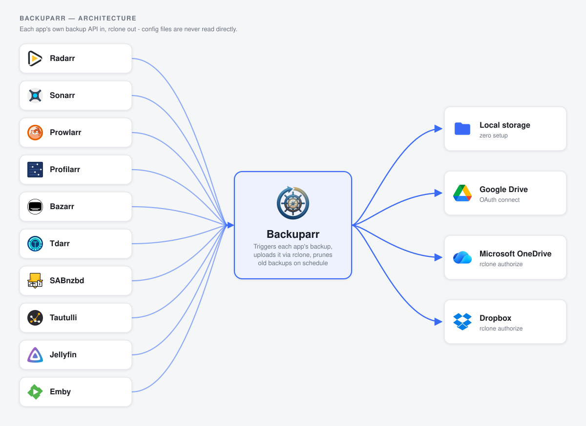

# Backuparr

**Backup your Arrs.**

> **AI disclosure:** This project was built with substantial assistance
> from Claude (Anthropic) - code, documentation, and commit history
> included. Reviewed and maintained by a human.

Scheduled config/database backups for Radarr, Sonarr, Prowlarr, Profilarr,
Bazarr, Tdarr, SABnzbd, NZBGet, Tautulli, Jellyfin, Emby, Plex, and Seerr, sent
to every destination you enable: Local storage, Google Drive, OneDrive, and
Dropbox. Everything - apps, destinations, schedule, retention and restores - is
set up in the web UI, not env vars.

Most apps are backed up through their own API. Jellyfin, Emby, Plex and Seerr
also need a folder mounted into Backuparr - see the [per-app
notes](#per-app-backup-method).

See [CHANGELOG.md](CHANGELOG.md) for release history.

## Table of contents

- [Quick start](#quick-start)
  - [Pull the published image (recommended)](#pull-the-published-image-recommended)
  - [Or build from source](#or-build-from-source)
  - [First run](#first-run)
- [Architecture](#architecture)
- [Why not reuse an existing tool?](#why-not-reuse-an-existing-tool)
- [Per-app backup method](#per-app-backup-method)
  - [Profilarr note](#profilarr-note)
  - [Tautulli note](#tautulli-note)
  - [Jellyfin note](#jellyfin-note)
  - [Emby note](#emby-note)
  - [Plex note](#plex-note)
  - [Seerr note](#seerr-note)
  - [NZBGet note](#nzbget-note)
  - [Bazarr auth note](#bazarr-auth-note)
  - [Tdarr auth note](#tdarr-auth-note)
- [Settings and security](#settings-and-security)
  - [Prowlarr discovery](#prowlarr-discovery)
  - [Service authentication headers](#service-authentication-headers)
  - [Login](#login)
  - [Encryption at rest](#encryption-at-rest)
- [Environment variables](#environment-variables)
- [Destinations](#destinations)
- [Restoring after a disaster](#restoring-after-a-disaster)
- [Notifications](#notifications)
- [Configuration reference](#configuration-reference)
- [Credits](#credits)
- [License](#license)

## Quick start

Add a `backuparr` service to the compose file that already defines your apps,
so it shares their network and can reach them by name.

### Pull the published image (recommended)

```yaml
services:
  backuparr:
    image: rsaturns/backuparr:latest
    container_name: backuparr
    restart: unless-stopped
    environment:
      - TZ=America/Los_Angeles
      - PUID=1000
      - PGID=1000
      # Optional - see Environment variables.
      #- LOG_LEVEL=INFO
      #- BACKUPARR_FORCE_HTTPS=true
      #- BACKUPARR_DISABLE_AUTH=true
      #- BACKUPARR_SECRETS_KEY=
      #- RCLONE_CONFIG_PASS=
      # Changing this also means updating the ports: mapping below.
      #- WEBUI_PORT=8990
    ports:
      - "8990:8990"
    volumes:
      # config.json, rclone.conf, and local-destination backups.
      - /share/Container/backuparr:/config/backuparr
      # Optional: needed only to restore Bazarr - path to its config/backup folder.
      #- /share/Container/bazarr/backup:/mnt/bazarr-backup
      # Needed to back up Jellyfin - its backups folder (see the Jellyfin note).
      #- /share/Container/jellyfin/config/data/backups:/mnt/jellyfin-backups
      # Needed to back up Emby - its /config folder (see the Emby note).
      #- /share/Container/emby/config:/mnt/emby:ro
      # Needed to back up Plex - its "Plex Media Server" folder (see the Plex note).
      #- "/share/Container/plex/Library/Application Support/Plex Media Server:/mnt/plex:ro"
      # Needed to back up Seerr - its /app/config folder (see the Seerr note).
      #- /share/Container/seerr/config:/mnt/seerr:ro
```

```sh
docker compose up -d
```

Or without Compose:

```sh
docker run -d --name backuparr --restart unless-stopped \
  -e TZ=America/Los_Angeles -e PUID=1000 -e PGID=1000 \
  -p 8990:8990 \
  -v /share/Container/backuparr:/config/backuparr \
  rsaturns/backuparr:latest
```

Published for `linux/amd64` and `linux/arm64`. `latest` is the newest tagged
release; pin a version (e.g. `rsaturns/backuparr:1.7.0-beta`) to control
upgrades. Tags are on [Docker Hub](https://hub.docker.com/r/rsaturns/backuparr).

### Or build from source

Clone this repo and use its `docker-compose.yml` (or replace the `image:` line
above with `build: .`):

```sh
docker compose up -d --build backuparr
```

### First run

Open `http://<host>:8990` and create the admin account on the setup screen.
Then, on the **Settings** tab:

1. Switch on each app to back up, enter its URL (e.g. `http://radarr:7878` on
   the same Compose network, or `IP:port` for apps on host networking) and its
   API key, and click **Test connection**. Using Prowlarr? Set it up first and
   click **Discover services** - see [Prowlarr discovery](#prowlarr-discovery).
2. Enable at least one [destination](#destinations).
3. Set retention and a schedule.
4. Click **Save settings**. Schedule changes apply without a restart.

**Run & Status** runs a backup now and shows it live, **History** lists, downloads
and deletes backups, and **Restore** restores them.

## Architecture



## Why not reuse an existing tool?

[Zerka30/servarr-backup](https://github.com/Zerka30/servarr-backup) does this
for Radarr/Sonarr/Prowlarr to S3. Backuparr covers more apps and sends backups
through [rclone](https://rclone.org/) to Local storage, Google Drive (connected
in the UI), and OneDrive or Dropbox (a one-time `rclone authorize` paste) -
no rclone config wizard needed.

## Per-app backup method

| App | Backup | Restore |
|---|---|---|
| Radarr / Sonarr / Prowlarr | The app's own backup zip (`POST /system/backup`), downloaded and then deleted on the server | Uploaded to `/system/backup/restore/upload`; the app restarts itself |
| Profilarr | The app's own backup (`POST /api/v1/backups`), downloaded and then deleted on the server | Manual only - see the [Profilarr note](#profilarr-note) |
| Bazarr | The app's own backup (`POST /api/system/backups`), downloaded and then deleted on the server | Written into Bazarr's mounted backup folder, then restored over the API. Downloads depend on Bazarr's web auth - see the [Bazarr auth note](#bazarr-auth-note) |
| Tdarr | Every internal database collection, read over `/api/v2/cruddb` | Destructive: each collection is wiped, then refilled |
| SABnzbd | `get_config` over the API. SABnzbd masks every password as `**********` | Settings and Usenet servers over `set_config`; you're asked for each server's password. Categories, RSS feeds and sorters aren't restored |
| NZBGet | Every setting, real passwords included, over JSON-RPC `loadconfig` | `saveconfig`, then NZBGet reloads - see the [NZBGet note](#nzbget-note) |
| Tautulli | `download_database` and `download_config` | Config only, via `import_config` - see the [Tautulli note](#tautulli-note) |
| Jellyfin (10.11+) | Jellyfin's own backup (`POST /Backup/Create`), picked up from its mounted backups folder | Over `POST /Backup/Restore`; Jellyfin restarts - see the [Jellyfin note](#jellyfin-note) |
| Emby | Settings, plugins, lists and databases from its mounted data folder, while Emby runs | Written back while Emby is stopped - see the [Emby note](#emby-note) |
| Plex | Plex's database export (`GET /diagnostics/databases`) plus `Preferences.xml` from its mounted data folder | Written back while Plex is stopped; the server keeps its identity - see the [Plex note](#plex-note) |
| Seerr | Database and `settings.json` from its mounted config folder, while Seerr runs | Written back while Seerr is stopped - see the [Seerr note](#seerr-note) |

For the apps with a mounted folder, read-only is enough for backups; restoring
from the web UI needs it read-write, with Backuparr running as the app's
`PUID`/`PGID` (or otherwise able to write the app's files).

### Profilarr note

Profilarr strips secrets from its backups: arr URLs and API keys, sync
configs, notification webhooks and tokens, user accounts and sessions, linked
database tokens, and AI/TMDB keys. Re-add them after a restore.

Profilarr's restore has no API, so it isn't on the **Restore** tab. To restore
by hand: download the backup from Backuparr's **History** tab, upload and
restore it in Profilarr's **Settings > Backups**, then restart Profilarr.

### Tautulli note

- **Backup:** `download_database` removes Plex tokens, but `download_config`
  only removes `PMS_TOKEN`/`JWT_SECRET`. **The Tautulli API key and any
  notification credentials are in the backup in plain text** - rotate the key
  if a destination is ever compromised.
- **Restore** uploads the config, then asks Tautulli to apply it. With no login
  set up in Tautulli, it applies and Tautulli restarts. With a login enabled,
  the config is only staged: log in to Tautulli and open
  `<your Tautulli URL>/restart_import_config` (the Restore tab shows it). If
  Tautulli restarts first, the staged config is lost; restore again.
- **The database can't be restored over the API** (an upstream Tautulli bug):
  import `tautulli.db` by hand in Tautulli's **Settings > Import & Backup >
  Import Database**.

### Jellyfin note

Jellyfin creates backups through its API but can't download or upload them, so
mount **Jellyfin's backups folder** into Backuparr. It is
`/config/data/backups` in the official image and `/config/data/data/backups` in
linuxserver's:

```yaml
    volumes:
      # official image, with Jellyfin's /config at /share/Container/jellyfin/config
      - /share/Container/jellyfin/config/data/backups:/mnt/jellyfin-backups
      # or linuxserver image, with Jellyfin's /config at /share/Container/jellyfin
      # - /share/Container/jellyfin/data/data/backups:/mnt/jellyfin-backups
```

Then fill in the card: the URL, an API key from **Dashboard > API Keys** (a
user's sign-in token can't manage backups), and **Backups folder** =
`/mnt/jellyfin-backups`. If the path is wrong, **Test connection** names the
folder Jellyfin actually uses.

- **What's in the backup:** Jellyfin's database (users, watched state,
  playlists, collections, libraries, settings and API keys) and config files.
  Images and subtitles are left out; a library scan brings them back. The
  archive holds password hashes and API keys.
- **Mount the folder read-write**: Backuparr removes Jellyfin's copy of each
  archive after taking it, and a restore writes into the folder. Read-only,
  backups still work but restores don't.
- **Restore** replaces Jellyfin's database and settings, then Jellyfin restarts
  to apply them. The archive stays in Jellyfin's backups folder; delete it
  there when you're done. API keys come back too: after rebuilding Jellyfin, enter the
  new install's key under **Restore to a different target**, not in Settings -
  the key from the backup works again afterwards.
- **Reverse proxy:** Jellyfin takes its API key only in the `Authorization`
  header, so a proxy credential needs another header name.

### Emby note

Emby has no backup API, so Backuparr reads **Emby's data folder** (its
`/config`, in both the official and linuxserver images):

```yaml
    volumes:
      - /share/Container/emby/config:/mnt/emby:ro   # drop :ro to restore from the web UI
```

Then fill in the card: the URL, an API key from **Settings > Advanced > API
Keys**, and **Data folder** = `/mnt/emby`. **Test connection** also checks that
the folder belongs to this server.

- **What's in the backup:** the databases (users, watched state, favourites,
  playlists, collections, libraries, API keys), server and user settings,
  plugins, and the playlist and collection folders - copied safely while Emby
  runs. Images, cache, logs and transcodes are left out. The archive holds
  password hashes and API keys.
- **Restore needs Emby stopped** (`docker stop emby`); Backuparr refuses while
  it's running. It replaces everything above, then you start Emby. A backup
  from a newer Emby is refused. On a new install, start Emby once (the wizard
  can be skipped) and stop it before restoring. API keys come back too, so keep
  the original key in Settings.
- **To restore by hand:** stop Emby, extract the archive into its `/config`
  folder, delete any `data/*.db-wal` and `data/*.db-shm` files, and start Emby.

### Plex note

A Plex backup has two parts:

- **The library database** - Plex's own **Download Database** export:
  libraries, metadata, playlists, collections, and every user's watched state
  and ratings.
- **`Preferences.xml`** - the server's settings and its **identity**, which
  shared libraries are tied to. It's read from Plex's data folder. Restoring it
  brings a rebuilt server back as the *same* server; without it, every shared
  user has to be invited again.

Images, caches, codecs and plugins are left out; a library scan brings the
images back.

Mount Plex's data folder - `Library/Application Support/Plex Media Server`
inside its `/config`, in both the official and linuxserver images:

```yaml
    volumes:
      - "/share/Container/plex/Library/Application Support/Plex Media Server:/mnt/plex:ro"   # drop :ro to restore from the web UI
```

Then fill in the card: the URL, the **server owner's** Plex token, and **Data
folder** = `/mnt/plex`.

- **URL:** Plex usually runs with host networking, so use the host's address,
  not `http://plex:32400`. If Plex's **Secure connections** is **Preferred**
  (the default), `http://192.168.1.10:32400` works. If it's **Required**, use
  the server's `https://192-168-1-10.<id>.plex.direct:32400` address -
  Plex's certificate isn't valid for the bare IP. Backuparr connects to
  `plex.direct` names without a DNS lookup, so routers that block them don't
  matter.
- **Token:** click **Get Plex token** and sign in on Plex's website (your
  password never reaches Backuparr). It fills in the token, and the
  `plex.direct` address when the URL is empty or points at the same machine.
  If the popup is blocked, use the **Open Plex sign-in** link. You can also
  [find a token by hand](https://support.plex.tv/articles/204059436-finding-an-authentication-token-x-plex-token/).
- **The archive is sensitive:** `Preferences.xml` holds the server's plex.tv
  sign-in token.
- **Restore needs Plex stopped** (`docker stop plex`); Backuparr refuses while
  it's running. It replaces the database and `Preferences.xml`, then you start
  Plex. A backup from a newer Plex is refused; an older one is upgraded by Plex.
- **Rebuilding a server:** start the new Plex once (no need to sign in), stop
  it, then restore. It comes back as the original server with its shared
  users; keep the original token in Settings. Never run the original and the
  restored server at the same time.
- **To restore by hand**, follow Plex's guides to [restoring the
  database](https://support.plex.tv/articles/202485658-restore-a-database-backed-up-via-scheduled-tasks/)
  and [moving a server](https://support.plex.tv/articles/201370363-move-an-install-to-another-system/):
  put `com.plexapp.plugins.library.db` in `Plug-in Support/Databases` (deleting
  its `-wal` and `-shm` files) and `Preferences.xml` in the `Plex Media Server`
  folder.

### Seerr note

Seerr has no backup API, so Backuparr reads **Seerr's config folder** (its
`/app/config`):

```yaml
    volumes:
      - /share/Container/seerr/config:/mnt/seerr:ro   # drop :ro to restore from the web UI
```

Then fill in the card: the URL, the API key from **Settings > General**, and
**Data folder** = `/mnt/seerr`. Seerr only accepts its API key once its setup
is finished.

- **What's in the backup:** what [Seerr's backup
  guide](https://docs.seerr.dev/using-seerr/backups/) lists - the database
  (users, requests, issues, blocklist) and `settings.json` (every setting,
  including the media server, Radarr/Sonarr and notification credentials, and
  Seerr's API key). The image cache and logs are left out.
- **Only SQLite is supported** (Seerr's default). With PostgreSQL, use
  `pg_dump` as Seerr's guide describes.
- **Restore needs Seerr stopped** (`docker stop seerr`); Backuparr refuses while
  it's running. It replaces the database and `settings.json`, then you start
  Seerr. A backup from a newer Seerr is refused; an older one is upgraded by
  Seerr. Run Backuparr as `1000:1000` (Seerr's user in the official image).
- **Rebuilding:** start the new Seerr once (no need to finish setup), stop it,
  then restore. Its API key comes back too, so keep the original key in
  Settings (unless Seerr's `API_KEY` environment variable sets it).
- **To restore by hand:** stop Seerr, put `db/db.sqlite3` in its `db` folder
  (deleting any `db.sqlite3-wal` and `db.sqlite3-shm` there) and
  `settings.json` in its config folder, then start Seerr.

### NZBGet note

NZBGet has no API key. Fill in its card with the **Control** username and
password from **Settings > Security** (defaults `nzbget`/`tegbzn6789`); the
restricted and add-only users can't read every setting, so they're refused.
Leave both blank only if NZBGet has no password.

- **What's in the backup:** every setting in `nzbget.conf` - news servers with
  their passwords, categories, paths, RSS feeds, scheduler tasks, extension
  settings and NZBGet's own logins. The file uses NZBGet's **Backup settings**
  format, so NZBGet's own **Restore settings** can load it too. The queue,
  history and extension scripts aren't included.
- **Restore** replaces every setting and reloads NZBGet; the queue and history
  are kept. Paths come back as they were, so keep NZBGet's volume mounts the
  same. The backup's username and password come back too - update the card if
  they differ.
- **Reverse proxy:** NZBGet's login uses the `Authorization` header, so a proxy
  credential needs another header name.

### Bazarr auth note

Bazarr's backup download follows its **Settings > General > Security**, not
the API key:
- `None` - works as is.
- `Basic` - fill in the Basic auth username and password on Bazarr's card.
- `Forms` - not supported; switch to `None` or `Basic`, or authenticate at
  your reverse proxy.

### Tdarr auth note

If Tdarr has an API auth token enabled, put it in the optional API key field
on its card (it's sent as `Authorization: Bearer <key>`). Leave it blank if
Tdarr has no auth (the default).

## Settings and security

### Prowlarr discovery

Optional. Enter Prowlarr's URL and API key on its card and click **Discover
services**: Backuparr fills in the URLs and API keys of the Radarr, Sonarr and
SABnzbd instances Prowlarr knows, letting you choose when there are several.

- Only empty fields are filled, and nothing is saved until you save.
- Prowlarr masks those API keys, so Backuparr reads them from a temporary
  Prowlarr backup, which it then deletes. With Prowlarr on PostgreSQL, or a
  login proxy blocking `/backup/`, only the URLs are filled in.
- The URLs are the ones Prowlarr uses; **Test connection** confirms Backuparr
  can reach them.
- Other apps, including NZBGet, are configured by hand.

### Service authentication headers

For apps behind an authenticating reverse proxy, add headers under **Settings
→ Service authentication**. They're sent with every request to the apps -
tests, discovery, backups and restores - but never to cloud destinations,
OAuth providers or notification webhooks. Values are encrypted like API keys.

- A header goes to **all apps** unless you open **Apps** under it and pick
  some. One header name can be used on several rows, as long as no app gets it
  twice.
- An app's own authentication wins over a header of the same name - Tdarr's
  and NZBGet's `Authorization`, Jellyfin's `Authorization: MediaBrowser`. Use
  another header name (such as `Proxy-Authorization`) for the proxy.
- A configured `Cookie` is added alongside the app's cookies; a cookie the app
  already set wins.
- Requests to an app with headers must stay on its configured scheme, host and
  port, redirects included, so use its final URL.
  `BACKUPARR_ALLOW_CROSS_HOST_REDIRECTS` doesn't override this.
- **Generate Basic authentication** turns a username and password into a
  `Basic …` value for the header you choose, in your browser; only the header
  is saved.

If the API and backup downloads have different access rules, run a backup as
well as **Test connection**.

### Login

The admin account from the setup screen is required by default.

**Authentication at a reverse proxy:** if your proxy (e.g. Authelia) already
protects every request, set `BACKUPARR_DISABLE_AUTH=true` and recreate the
container. The UI and API then need no local login, and the setup, login,
logout and reset endpoints return `403`. **Block direct access to port 8990**:
anyone who reaches it has full access, stored credentials included.

**Forgot the password?** Click **Reset Backuparr** on the login screen. After
two confirmations it wipes local state - every app's API key, every cloud
connection, the admin account and local backups - and returns to the setup
screen. Backups already in Google Drive, OneDrive or Dropbox are untouched.

The reset works without logging in, gated only by a confirmation phrase that's
public in this repo. That's fine on a trusted LAN, but **don't expose port 8990
to an untrusted network** - put it behind a reverse proxy with its own login
and TLS.

### Encryption at rest

Every app's API key, Bazarr's and NZBGet's passwords, service authentication
header values, Google Drive's client secret, API key and refresh token,
OneDrive's and Dropbox's tokens, and the Notify URL are encrypted in
`config.json` with `secrets.key`, generated on first run (or set
`BACKUPARR_SECRETS_KEY` to keep it off the volume). `rclone.conf` is encrypted
with rclone's own config encryption, using a generated password in
`rclone.pass` (or `RCLONE_CONFIG_PASS`). It's always on.

Backup archives themselves aren't encrypted, and some hold app credentials
(see the per-app notes), so protect every destination.

## Environment variables

App settings live in `config.json` and are edited in the web UI (see the
[Configuration reference](#configuration-reference)). These are set in your
compose file:

| Env var | Default | Purpose |
|---|---|---|
| `WEBUI_HOST` | `0.0.0.0` | Address the web UI listens on (see below) |
| `WEBUI_PORT` | `8990` | Port the web UI listens on inside the container |
| `PUID` / `PGID` | `1000` / `1000` | User/group the container runs as. Match your host user (`id`) so files on the config volume are owned by you |
| `TZ` | UTC | Timezone for the schedule and `backup.log` timestamps |
| `UMASK` | `077` | Permissions of new files: by default only the container user can read backups (`0600`/`0700`). Set `022` if another user on the host reads the backup folder |
| `LOG_LEVEL` | `INFO` | Logging level for backup/restore runs, e.g. `DEBUG` |
| `BACKUPARR_SECRETS_KEY` | *(generated)* | Replaces the generated `secrets.key` (see [Encryption at rest](#encryption-at-rest)), e.g. from a Docker secret |
| `RCLONE_CONFIG_PASS` | *(generated)* | Replaces the generated password that encrypts `rclone.conf` |
| `BACKUPARR_DISABLE_AUTH` | `false` | `true` turns off local login behind an authenticating reverse proxy - see [Login](#login) |
| `BACKUPARR_FORCE_HTTPS` | `false` | Set `true` behind your own TLS reverse proxy: secure session cookie, and trusts `X-Forwarded-Proto`/`X-Forwarded-For` (needed for Google Drive's `https://` redirect URI). Leave unset on plain HTTP, or login fails |
| `BACKUPARR_ALLOW_CROSS_HOST_REDIRECTS` | `false` | `true` only if an app's URL redirects to a *different* host and you can't use the final address. By default such redirects are refused so credentials never go to another host |

To listen on loopback only: with bridge networking, publish
`ports: ["127.0.0.1:8990:8990"]` and leave `WEBUI_HOST` alone (setting it to
`127.0.0.1` there blocks the published port). With `network_mode: host`, set
`WEBUI_HOST: "127.0.0.1"` and remove `ports:`.

### Advanced: file locations

Only needed to move files out of the `/config/backuparr` mount, where they all
live by default.

| Env var | Default | What it is |
|---|---|---|
| `BACKUPARR_CONFIG` | `/config/backuparr/config.json` | The main config file |
| `RCLONE_CONFIG` | `/config/backuparr/rclone.conf` | rclone's remotes config |
| `RCLONE_CONFIG_PASS_FILE` | `/config/backuparr/rclone.pass` | Generated `rclone.conf` password (ignored if `RCLONE_CONFIG_PASS` is set) |
| `BACKUPARR_SECRETS_KEY_PATH` | `/config/backuparr/secrets.key` | Generated config-encryption key (ignored if `BACKUPARR_SECRETS_KEY` is set) |
| `BACKUPARR_SECRET_KEY_PATH` | `/config/backuparr/secret_key` | Session-signing key - not the same as `secrets.key` |
| `BACKUPARR_AUTH` | `/config/backuparr/auth.json` | Admin username and password hash |
| `BACKUPARR_LOG_DIR` | `/var/log/backuparr` | Where `backup.log` (shown on Run & Status) is written |

## Destinations

Enable one or more on the **Settings** tab; every run uploads to all of them.

### Local storage

No setup. Backups go to `/config/backuparr/backups`, on the same volume as
`config.json`. Set a custom path on the Local card to use another mounted
volume, such as a NAS share.

### Google Drive

Set up from the Google Drive card, with no rclone config:

1. Click **Setup guide** and follow it: it creates a Google Cloud project, the
   Drive API, an OAuth client and an API key, and shows the redirect URI to
   register. **Publish the OAuth app** as it says - apps left in Testing lose
   their connection every 7 days.
2. Paste the Client ID, Client Secret and API key, then **Save settings**. The
   **Choose folder** picker needs the API key.
3. Click **Connect Google Drive** and approve. Backuparr only asks for
   `drive.file` (files it created or you picked). Google warns the app is
   unverified; click **Advanced**, then **Go to (your app name) (unsafe)**.
4. Click **Choose folder** to pick or create the backup folder.

### OneDrive

Uses rclone's built-in Microsoft app - no Azure registration. Personal
Microsoft accounts only, not work/school (Microsoft 365).

1. On any computer with a browser, [download rclone](https://rclone.org/downloads/)
   and run `rclone authorize onedrive`.
2. Sign in and approve access.
3. Paste the block rclone prints after "Paste the following into your remote
   machine --->" into the OneDrive card and click **Connect OneDrive**.

Backups go to an `Apps/Backuparr` folder.

### Dropbox

Uses rclone's built-in Dropbox app - no developer account.

1. On any computer with a browser, [download rclone](https://rclone.org/downloads/)
   and run `rclone authorize dropbox`.
2. Sign in and approve access.
3. Paste the block rclone prints after "Paste the following into your remote
   machine --->" into the Dropbox card and click **Connect Dropbox**.

Backups go to a `Backuparr` folder.

## Restoring after a disaster

Re-create the app containers from your compose file, then on the **Restore**
tab pick the destination, the app and a backup, and confirm. The restore shows
live progress and a log.

**Restore to a different target** overrides the app's URL, key and other
fields for that restore only, without changing Settings - for a rebuilt or
renamed instance, or a trial restore on a throwaway copy.

- **Radarr / Sonarr / Prowlarr** - automatic; the app restarts.
- **Profilarr** - manual, see the [Profilarr note](#profilarr-note).
- **Bazarr** - needs Bazarr's config/backup folder mounted into Backuparr;
  enter it under "Bazarr backup folder" unless it's set in Settings.
- **Tdarr** - wipes each database collection before refilling it; you're
  asked to confirm.
- **SABnzbd** - asks for each Usenet server's password (leave any blank and
  set it in SABnzbd later).
- **NZBGet** - automatic; NZBGet reloads. See the [NZBGet note](#nzbget-note).
- **Tautulli** - config only, see the [Tautulli note](#tautulli-note).
- **Jellyfin** - automatic; Jellyfin restarts. See the [Jellyfin
  note](#jellyfin-note) before restoring onto a fresh install.
- **Emby, Plex, Seerr** - stop the app first, restore, then start it again. See
  the [Emby](#emby-note), [Plex](#plex-note) and [Seerr](#seerr-note) notes.

## Notifications

Set **Notify URL** on the Settings tab to get a summary after every run: one
✅/❌ line per app. Backuparr recognises the services below from the URL and
formats the message for them.

### Discord

In the channel: **Edit Channel > Integrations > Webhooks > New Webhook > Copy
Webhook URL**, and paste it into **Notify URL**.

### Slack

Create an [incoming webhook](https://api.slack.com/messaging/webhooks) and
paste its `https://hooks.slack.com/services/...` URL into **Notify URL**.

### Telegram

1. Create a bot with [@BotFather](https://t.me/BotFather) and copy its token.
2. Message the bot once, then open
   `https://api.telegram.org/bot<TOKEN>/getUpdates` and read `chat.id` (for a
   group, add the bot first and use the group's negative ID).
3. Set **Notify URL** to
   `https://api.telegram.org/bot<TOKEN>/sendMessage?chat_id=<CHAT_ID>`.

### Gotify

Create an application in Gotify and set **Notify URL** to
`https://<your-gotify-host>/message?token=<APP_TOKEN>`.

### ntfy.sh, Healthchecks.io, or anything else

Any other URL gets the message as a plain-text `POST`, which is
[ntfy.sh](https://ntfy.sh)'s format (e.g. `https://ntfy.sh/your-topic`). This
also works for [healthchecks.io](https://healthchecks.io) ping URLs, Uptime
Kuma push URLs, and other webhooks that accept raw text.

## Configuration reference

`config.json`, edited in the web UI or by hand:

| Field | Purpose |
|---|---|
| `apps.<name>.enabled/url/api_key` | Per app, as on the Settings tab |
| `apps.bazarr.username/password` | Only if Bazarr's web auth is `Basic` |
| `apps.nzbget.username/password` | NZBGet's Control username and password |
| `apps.jellyfin.backup_dir` | Jellyfin's mounted backups folder - required |
| `apps.emby.data_dir` | Emby's mounted data folder (its `/config`) - required |
| `apps.plex.data_dir` | Plex's mounted `Plex Media Server` folder - required |
| `apps.seerr.data_dir` | Seerr's mounted config folder (its `/app/config`) - required |
| `bazarr_backup_dir` | Bazarr's mounted config/backup folder, for restores |
| `request_headers` | [Service authentication headers](#service-authentication-headers): `[{"name": "Proxy-Authorization", "value": "Basic …", "apps": ["radarr"]}]`; omit `apps` for every app |
| `destinations.local.enabled/path` | Local storage; the path defaults to `/config/backuparr/backups` |
| `destinations.gdrive.enabled/client_id/client_secret/developer_key` | Google Drive OAuth client and API key, from the Setup guide |
| `destinations.gdrive.refresh_token/folder_id/folder_name` | Set by Connect/Choose folder - don't edit |
| `destinations.onedrive.enabled`, `destinations.dropbox.enabled` | Whether the destination is used |
| `destinations.onedrive.token/drive_id/drive_type/item_id`, `destinations.dropbox.token` | Set by the Connect buttons - don't edit |
| `retention_days` | Delete backups older than this, per app and destination (default 7) |
| `cron_schedule` | 5-field cron schedule (default `0 3 * * *`) |
| `notify_url` | Optional summary after every run - see [Notifications](#notifications) |

## Credits

App icons (`webui/static/icons/`) are from the [selfh.st icon
collection](https://selfh.st/icons/) ([selfhst/icons on
GitHub](https://github.com/selfhst/icons)), licensed
[CC BY 4.0](https://github.com/selfhst/icons/blob/main/LICENSE).

## License

[GNU AGPLv3](LICENSE) - if you run a modified version as a network service,
its source must be available to its users too.
