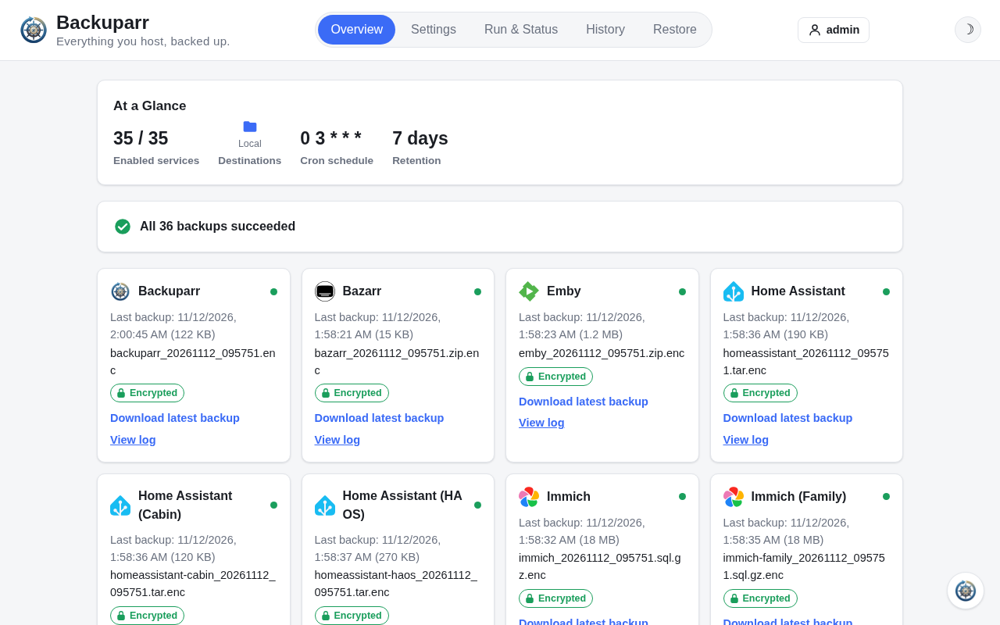
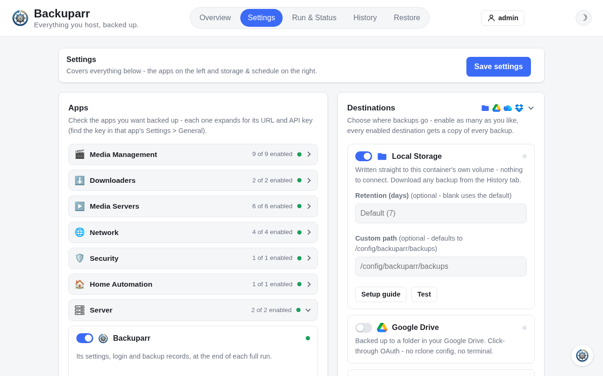
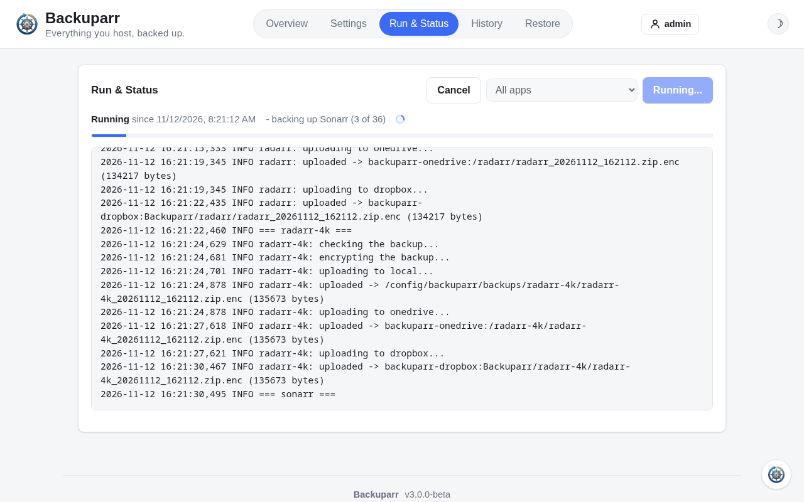
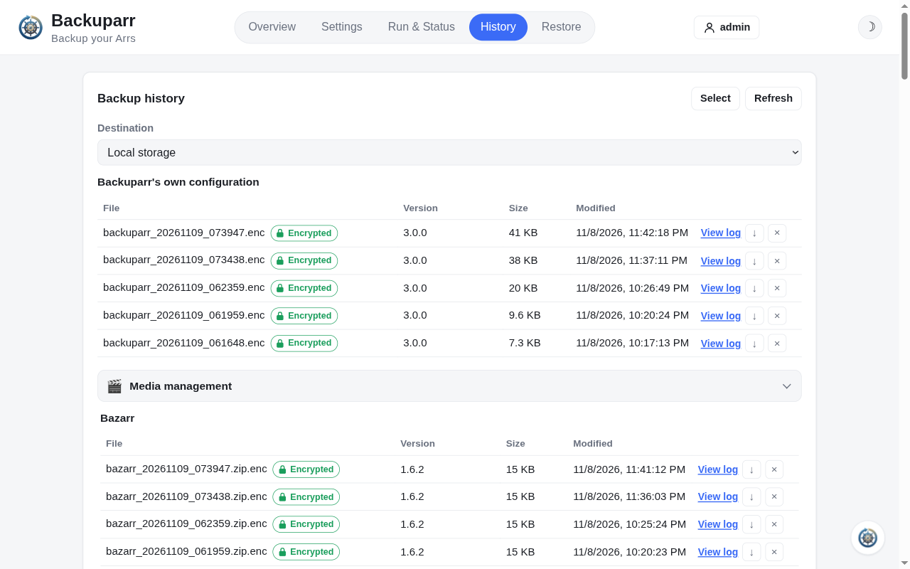

# Backuparr

**Backup your Arrs.**

> **AI disclosure:** This project was built with substantial assistance
> from Claude (Anthropic) - code, documentation, and commit history
> included. Reviewed and maintained by a human.

Scheduled config/database backups for Radarr, Sonarr, Lidarr, Prowlarr,
Profilarr, Bazarr, Tdarr, SABnzbd, NZBGet, Tautulli, Jellyfin, Emby, Plex, and
Seerr, sent to every destination you enable: Local storage, Google Drive,
OneDrive, and Dropbox. Everything - apps, destinations, schedule, retention and
restores - is set up in the web UI, not env vars.

Most apps are backed up through their own API. Jellyfin, Emby, Plex and Seerr
also need a folder mounted into Backuparr - see the [app
notes](https://rsaturns.github.io/backuparr/apps/).

**[Documentation](https://rsaturns.github.io/backuparr/)** · [Changelog](CHANGELOG.md)

## Screenshots

<table>
  <tr>
    <td><br><b>Overview</b></td>
    <td><br><b>Settings</b></td>
  </tr>
  <tr>
    <td><br><b>Run &amp; Status</b></td>
    <td><br><b>History</b></td>
  </tr>
</table>

## Quick start

### Docker

Add a `backuparr` service to the compose file that already defines your apps,
so it shares their network and can reach them by name.

```yaml
services:
  backuparr:
    image: rsaturns/backuparr:latest
    container_name: backuparr
    restart: unless-stopped
    environment:
      - TZ=America/Los_Angeles
      - PUID=1000
      - PGID=1000
      # Optional - see Environment variables.
      #- LOG_LEVEL=INFO
      #- BACKUPARR_FORCE_HTTPS=true
      #- BACKUPARR_DISABLE_AUTH=true
      #- BACKUPARR_SECRETS_KEY=
      #- RCLONE_CONFIG_PASS=
      # Changing this also means updating the ports: mapping below.
      #- WEBUI_PORT=8990
    ports:
      - "8990:8990"
    volumes:
      # config.json, rclone.conf, and local-destination backups.
      - /share/Container/backuparr:/config/backuparr
      # Optional: needed only to restore Bazarr - path to its config/backup folder.
      #- /share/Container/bazarr/backup:/mnt/bazarr-backup
      # Needed to back up Jellyfin - its backups folder (see the Jellyfin note).
      #- /share/Container/jellyfin/config/data/backups:/mnt/jellyfin-backups
      # Needed to back up Emby - its /config folder (see the Emby note).
      #- /share/Container/emby/config:/mnt/emby:ro
      # Needed to back up Plex - its "Plex Media Server" folder (see the Plex note).
      #- "/share/Container/plex/Library/Application Support/Plex Media Server:/mnt/plex:ro"
      # Needed to back up Seerr - its /app/config folder (see the Seerr note).
      #- /share/Container/seerr/config:/mnt/seerr:ro
```

```sh
docker compose up -d
```

Or without Compose:

```sh
docker run -d --name backuparr --restart unless-stopped \
  -e TZ=America/Los_Angeles -e PUID=1000 -e PGID=1000 \
  -p 8990:8990 \
  -v /share/Container/backuparr:/config/backuparr \
  rsaturns/backuparr:latest
```

Published for `linux/amd64` and `linux/arm64`. `latest` is the newest tagged
release; pin a version (e.g. `rsaturns/backuparr:1.10.2`) to control
upgrades. Tags are on [Docker Hub](https://hub.docker.com/r/rsaturns/backuparr),
and the same images are on GitHub Container Registry as
[`ghcr.io/rsaturns/backuparr`](https://github.com/rsaturns/backuparr/pkgs/container/backuparr).

The optional settings are covered in
[Docker](https://rsaturns.github.io/backuparr/getting-started/docker/), and
building the image yourself in
[Build from source](https://rsaturns.github.io/backuparr/getting-started/build-from-source/).

### Unraid

On the **Apps** tab, search for **Backuparr** and click **Install**. The
template uses the same image, with appdata in `/mnt/user/appdata/backuparr`;
fill in the folders of the apps that need one - see
[Unraid](https://rsaturns.github.io/backuparr/getting-started/unraid/).

### First run

Open `http://<host>:8990` and create the admin account on the setup screen.
Then, on the **Settings** tab:

1. Switch on each app to back up, enter its URL (e.g. `http://radarr:7878` on
   the same Compose network, or `IP:port` for apps on host networking) and its
   API key, and click **Test connection**. Using Prowlarr? Set it up first and
   click **Discover services** - see [Prowlarr discovery](https://rsaturns.github.io/backuparr/settings/#prowlarr-discovery).
2. Enable at least one [destination](https://rsaturns.github.io/backuparr/destinations/).
3. Set retention and a schedule. Retention deletes each app's backups older
   than the number of days you set, but always keeps its newest one.
4. Click **Save settings**. Schedule changes apply without a restart.

**Run & Status** runs a backup now - of every app, or just one - and shows it
live, **History** lists, downloads and deletes backups, and **Restore** restores them.

## Documentation

- [Getting started](https://rsaturns.github.io/backuparr/getting-started/)
- [Apps](https://rsaturns.github.io/backuparr/apps/) - how each app is backed up and restored
- [Destinations](https://rsaturns.github.io/backuparr/destinations/) - Local storage, Google Drive, OneDrive, Dropbox
- [Settings](https://rsaturns.github.io/backuparr/settings/) - Prowlarr discovery, multiple instances of an app, reverse-proxy headers
- [Login and security](https://rsaturns.github.io/backuparr/security/)
- [Restoring after a disaster](https://rsaturns.github.io/backuparr/restoring/)
- [Notifications](https://rsaturns.github.io/backuparr/notifications/)
- [Environment variables](https://rsaturns.github.io/backuparr/environment-variables/) and the [configuration reference](https://rsaturns.github.io/backuparr/configuration/)

Want to help? See [CONTRIBUTING.md](CONTRIBUTING.md) and the [Code of Conduct](CODE_OF_CONDUCT.md).

## Credits

App icons (`webui/static/icons/`) are from the [selfh.st icon
collection](https://selfh.st/icons/) ([selfhst/icons on
GitHub](https://github.com/selfhst/icons)), licensed
[CC BY 4.0](https://github.com/selfhst/icons/blob/main/LICENSE).

## License

[GNU AGPLv3](LICENSE) - if you run a modified version as a network service,
its source must be available to its users too.
