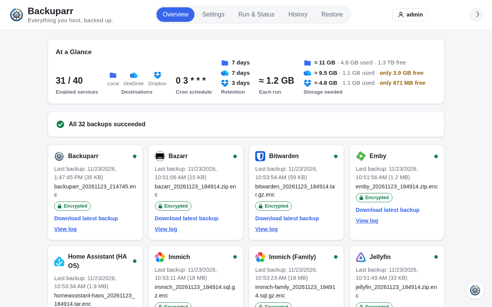
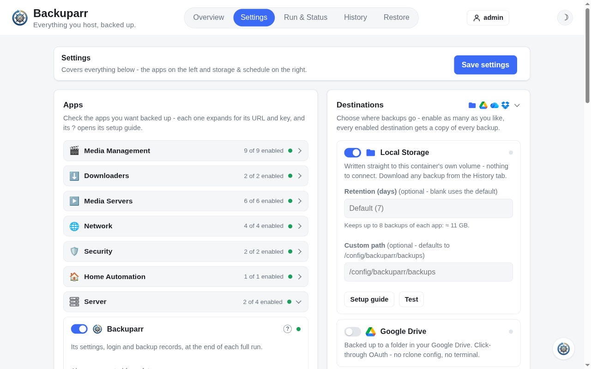
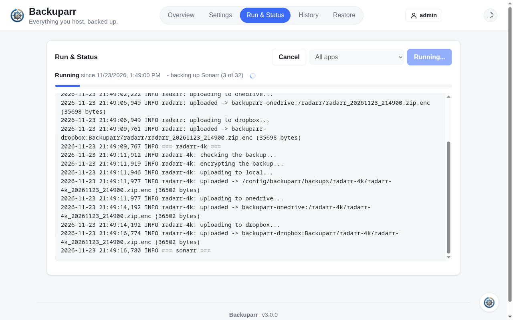
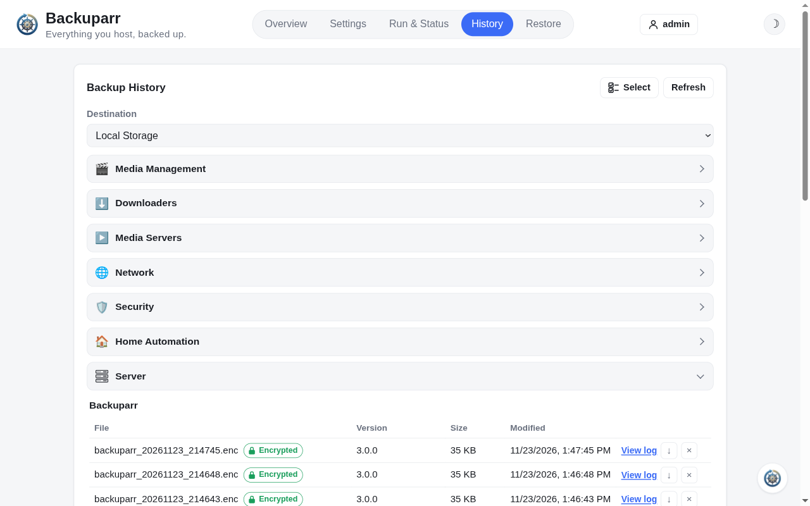

# Backuparr

[](https://www.bestpractices.dev/projects/17050)
[](https://www.bestpractices.dev/projects/17050)

**Everything you host, backed up.**

> **AI disclosure:** This project was built with substantial assistance
> from Claude (Anthropic) - code, documentation, and commit history
> included. Reviewed and maintained by a human.

Scheduled backups of the apps you host - media management, downloaders,
media servers, network, security, home automation and server apps - sent to
every destination you enable: Local Storage, Google Drive, OneDrive and
Dropbox. Backups are encrypted with your own key by default, and most apps
restore from the web UI. Everything - apps, destinations, schedule, retention
and restores - is set up in the web UI, not env vars.

Most apps are backed up through their own API or web UI; some also need
their folder mounted into Backuparr. See the
[full list of apps](https://docs.backuparr.com/apps/). How your
backups and credentials are kept safe:
[Security principles](https://docs.backuparr.com/security-principles/).

**[Website](https://backuparr.com)** · **[Documentation](https://docs.backuparr.com/)** · [Changelog](CHANGELOG.md)

If you like Backuparr, give it a ⭐ star - it helps the project grow.

## Features

- **The apps you host:** Radarr, Sonarr, SABnzbd, Plex, Jellyfin and the
  rest of your media stack, plus your network, passwords, smart home, photos
  and servers - Pi-hole, OPNsense, pfSense, UniFi, Vaultwarden, Bitwarden,
  Home Assistant, Immich, Unraid, Synology DSM and QNAP QuTS hero. See the
  [full list](https://docs.backuparr.com/apps/).
- **Every destination at once:** Local Storage, Google Drive, OneDrive and
  Dropbox, connected in the web UI, with retention set once or per
  destination.
- **Encrypted with your key** before upload - always for sensitive apps such
  as password managers, firewalls and Home Assistant - and the image's
  `decrypt` command opens a backup without Backuparr.
- **Restores from the web UI** for most apps, onto the app version the backup
  came from. Apps restored in their own UI, such as firewalls, UniFi and
  Unraid, get the download and the steps on the Restore tab.
- **How much room backups need:** what each run uploads, and the storage each
  destination's retention needs beside what's used and free.
- **Secure by default:** HTTPS on port 8991 with a certificate Backuparr
  makes itself, self-signed app certificates pinned rather than skipped,
  credentials encrypted at rest, and signed images with an SBOM. See
  [Security principles](https://docs.backuparr.com/security-principles/).
- **At a glance:** the Overview sums up every app's last backup, a summary
  after each run goes to Discord, Slack, Telegram, Gotify, ntfy or a webhook,
  and the [Home Assistant integration](https://github.com/rsaturns/ha-backuparr)
  gives a sensor per app that turns on when its backup fails.
- **Backs itself up:** Backuparr's own settings, login and backup record,
  encrypted, restored from the setup screen on a new install.

All of it is in [Features](https://docs.backuparr.com/features/).

## Screenshots

<table>
  <tr>
    <td><br><b>Overview</b></td>
    <td><br><b>Settings</b></td>
  </tr>
  <tr>
    <td><br><b>Run &amp; Status</b></td>
    <td><br><b>History</b></td>
  </tr>
</table>

## Quick start

### Docker

Add a `backuparr` service to the compose file that already defines your apps,
so it shares their network and can reach them by name.

```yaml
services:
  backuparr:
    image: rsaturns/backuparr:latest
    container_name: backuparr
    restart: unless-stopped
    environment:
      - TZ=America/Los_Angeles
      - PUID=1000
      - PGID=1000
    ports:
      - "8990:8990"   # HTTP
      - "8991:8991"   # HTTPS, self-signed certificate
    volumes:
      # config.json, rclone.conf, and local-destination backups.
      - /share/Container/backuparr:/config/backuparr
```

```sh
docker compose up -d
```

Or without Compose:

```sh
docker run -d --name backuparr --restart unless-stopped \
  -e TZ=America/Los_Angeles -e PUID=1000 -e PGID=1000 \
  -p 8990:8990 -p 8991:8991 \
  -v /share/Container/backuparr:/config/backuparr \
  rsaturns/backuparr:latest
```

Published for `linux/amd64` and `linux/arm64`. `latest` is the newest full
release; a beta gets only its own tag, so `latest` never moves to one. Pin a
version (such as `rsaturns/backuparr:3.0.2`) to control upgrades. Tags are on [Docker Hub](https://hub.docker.com/r/rsaturns/backuparr),
and the same images are on GitHub Container Registry as
[`ghcr.io/rsaturns/backuparr`](https://github.com/rsaturns/backuparr/pkgs/container/backuparr).

[Docker](https://docs.backuparr.com/getting-started/docker/) has the
full example, with the folders some apps need mounted and the optional
settings, and
[Build from source](https://docs.backuparr.com/getting-started/build-from-source/)
covers building the image yourself.

### Unraid

On the **Apps** tab, search for **Backuparr** and click **Install**. The
template uses the same image, with appdata in `/mnt/user/appdata/backuparr`;
fill in the folders of the apps that need one - see
[Unraid](https://docs.backuparr.com/getting-started/unraid/).

### First run

Open `https://<host>:8991` (or `http://<host>:8990`) and create the admin account on the setup screen
(or [restore Backuparr](https://docs.backuparr.com/restoring/#restoring-backuparr-itself) from its own
backup). Save the encryption key Backuparr then shows - you need it to restore
Backuparr. Then, on the **Settings** tab:

1. Switch on each app to back up, enter its URL (e.g. `http://radarr:7878` on
   the same Compose network, or `IP:port` for apps on host networking) and its
   API key, and click **Test connection**. Using Prowlarr? Set it up first and
   click **Discover services** - see [Prowlarr discovery](https://docs.backuparr.com/settings/#prowlarr-discovery).
2. Enable at least one [destination](https://docs.backuparr.com/destinations/).
3. Set retention and a schedule. Retention deletes each app's backups older
   than the number of days you set, but always keeps its newest one.
4. Click **Save settings**.

**Run & Status** runs a backup now - of every app, or just one - and shows it
live, **History** lists, downloads and deletes backups, and **Restore** restores them.

## Documentation

- [Features](https://docs.backuparr.com/features/) - everything Backuparr does, in one list
- [Getting started](https://docs.backuparr.com/getting-started/)
- [Apps](https://docs.backuparr.com/apps/) - how each app is backed up and restored
- [Destinations](https://docs.backuparr.com/destinations/) - Local Storage, Google Drive, OneDrive, Dropbox
- [Settings](https://docs.backuparr.com/settings/) - Prowlarr discovery, multiple instances of an app, reverse-proxy headers
- [Backups and history](https://docs.backuparr.com/backups/) - schedule, retention, run logs, History
- [Restoring](https://docs.backuparr.com/restoring/) - apps, the version check, and Backuparr itself
- [Login and security](https://docs.backuparr.com/security/)
- [Notifications](https://docs.backuparr.com/notifications/)
- [Home Assistant](https://docs.backuparr.com/home-assistant/) - the [Backuparr integration](https://github.com/rsaturns/ha-backuparr) and a read-only status
- [Environment variables](https://docs.backuparr.com/environment-variables/) and the [configuration reference](https://docs.backuparr.com/configuration/)

## Feedback and contributing

- **Found a bug?** Open a [bug report](https://github.com/rsaturns/backuparr/issues/new?template=bug_report.yml).
- **Want a feature or another app?** Open a [feature request](https://github.com/rsaturns/backuparr/issues/new?template=feature_request.yml).
- **Found a security problem?** Don't open an issue - report it privately, as [SECURITY.md](SECURITY.md) explains.
- **No GitHub account?** Send any of these from [backuparr.com/report](https://backuparr.com/report/). The maintainer reads each one first.
- **Want to help?** See [CONTRIBUTING.md](CONTRIBUTING.md) and the [Code of Conduct](CODE_OF_CONDUCT.md).

## Credits

App icons (`webui/static/icons/`) are from the [selfh.st icon
collection](https://selfh.st/icons/) ([selfhst/icons on
GitHub](https://github.com/selfhst/icons)), licensed
[CC BY 4.0](https://github.com/selfhst/icons/blob/main/LICENSE), except
Synology DSM's (`synology.png`), which is Synology's own icon from
[synology.com](https://www.synology.com/).

The Server category's icons (`server-outline.png`, `server-filled.png`):
<a href="https://www.flaticon.com/free-icons/server" title="server icons">Server icons created by Magnific - Flaticon</a>

## License

[GNU AGPLv3](LICENSE) - if you run a modified version as a network service,
its source must be available to its users too.
