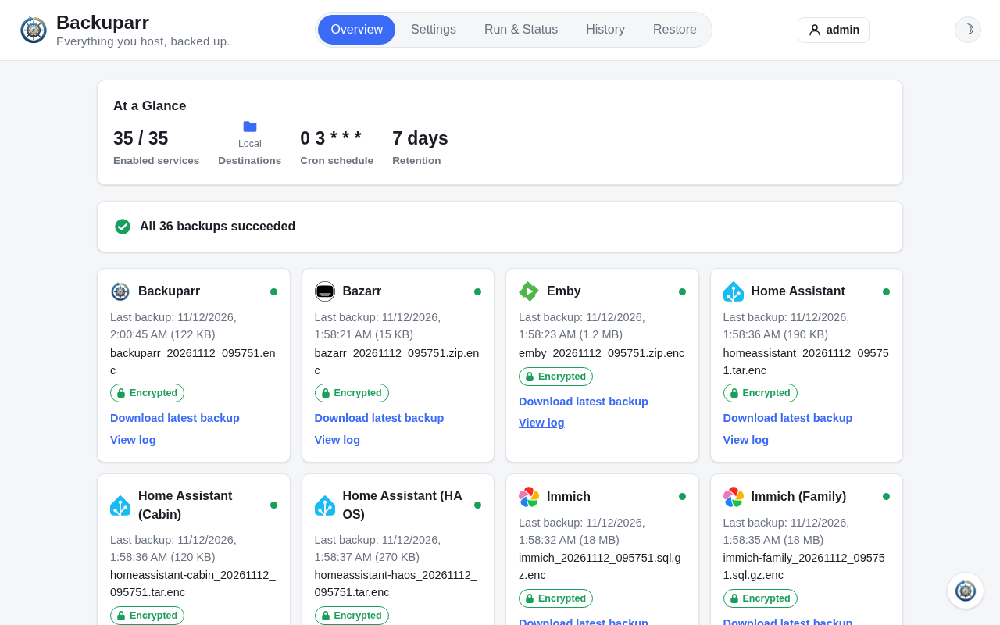

# Backuparr

**Backup your Arrs.**

Scheduled config/database backups for Radarr, Sonarr, Lidarr, Whisparr,
Prowlarr, Profilarr, Bazarr, Tdarr, SABnzbd, NZBGet, Tautulli, Jellyfin, Emby,
Plex, and Seerr, sent to every destination you enable: Local storage, Google
Drive, OneDrive, and Dropbox. Everything - apps, destinations, schedule,
retention and restores - is set up in the web UI, not env vars.

Most apps are backed up through their own API. Jellyfin, Emby, Plex and Seerr
also need a folder mounted into Backuparr - see [Apps](apps/index.md).

[Get started](getting-started.md){: .btn .btn-primary }
[View on GitHub](https://github.com/rsaturns/backuparr){: .btn }

## Where to find things

- [Getting started](getting-started.md) - install with
  [Docker](getting-started/docker.md), on [Unraid](getting-started/unraid.md)
  or [from source](getting-started/build-from-source.md), and the
  [first run](getting-started/first-run.md).
- [Apps](apps/index.md) - how each app is backed up and restored, with the notes
  for apps that need extra setup.
- [Destinations](destinations.md) - Local storage, Google Drive, OneDrive and
  Dropbox.
- [Settings](settings.md) - Prowlarr discovery, more than one instance of an
  app, and authentication headers for apps behind a reverse proxy.
- [Login and security](security.md) - the admin login, resetting it, and
  encryption at rest.
- [Restoring after a disaster](restoring.md)
- [Notifications](notifications.md) - Discord, Slack, Telegram, Gotify, ntfy and
  more.
- [Environment variables](environment-variables.md) and the
  [Configuration reference](configuration.md).

See the [changelog](https://github.com/rsaturns/backuparr/blob/main/CHANGELOG.md)
for release history.

> **AI disclosure:** This project was built with substantial assistance
> from Claude (Anthropic) - code, documentation, and commit history
> included. Reviewed and maintained by a human.
